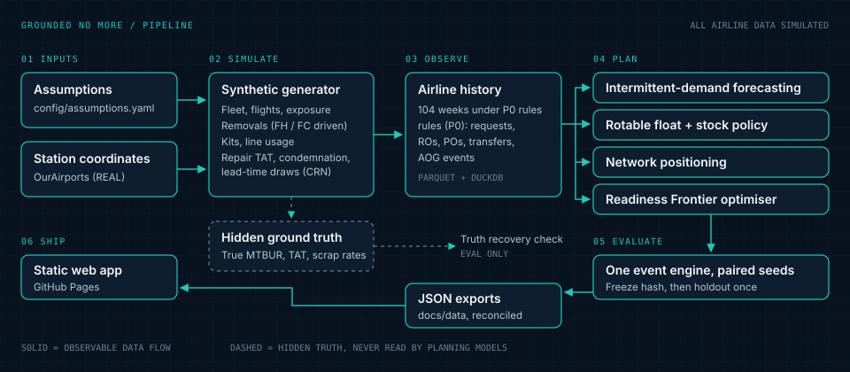

# GROUNDED NO MORE

**A single missing part can ground an aircraft. Know which ones, where, and what to do about it.**

[](https://github.com/akashgajjar07-hue/grounded-no-more/actions/workflows/ci.yml)

[](LICENSE)

**Web app (GitHub Pages):** <https://akashgajjar07-hue.github.io/grounded-no-more/>


An aviation spare-parts intelligence project for a fictional airline, **Falcon Hub Airways (fictional)**. It forecasts sparse, removal-driven demand, sizes rotable floats against repair turnaround, decides what to hold at the hub and what to push to outstations, and shows how much material shortage exposure each extra dirham of spares capital removes. Everything runs from one seeded pipeline and ends in a static web app a materials planner could use on a Monday morning.

> **All airline data in this project is simulated: every screen is a simulated planning snapshot.** Station coordinates are real (OurAirports). Every parameter is in [`config/assumptions.yaml`](config/assumptions.yaml) with a provenance tag. Nothing here is measured aviation reliability or any operator's data.

---

## Headline

Holdout results: 20 paired seeds (2000–2019), 52 weeks (weeks 104–155), central world, run once after the freeze. "Material AOG" means expected material-related downtime hours: the hours an aircraft waits for a part that was not available in time, including fitting and release-to-service time.

**Network positioning (P2) cuts material AOG by 1,480 h a year [1,332–1,629] vs a legacy OEM-quote policy holding only 8 outstation rotables, for about +AED 0.6M of spares capital.** P2 holds 44 rotables at the six outstations instead of 8 and pools the rest at the hub. Material AOG falls from 1,690 h to 210 h a year (88% lower) on the holdout (seeds 2000–2019, paired 95% CI). It holds in all three calibrated worlds and across the ×0.5–×2 range of the hourly AOG penalty.

**Frontier option: if you invest an additional AED 7.6M**, the frontier point I125 (P2 plus greedy rotable additions) cuts a further 134 h a year [87–181] vs P2 (76 h vs 210 h) and lowers total annual cost by AED 3.3M [1.8–4.8] (holdout, paired). Sensitivity, on the selection seeds and one factor at a time: its cost lead over P2 is not significant if repair is 25% faster (+AED 0.36M [−0.75 to 1.46] a year), and the pre-stated rule moves to I110 at ×0.5 and B150 at ×2 the hourly rate. Post-plan check (D015, added after the main holdout, no re-selection): low stress −85 h [−125 to −45] a year and total annual cost −AED 1.7M [−2.9 to −0.4] for +AED 7.7M capital (I125 62 h vs central-built P2 147 h); high stress −184 h [−239 to −128] a year and total annual cost −AED 5.0M [−6.8 to −3.1] for +AED 7.5M capital (I125 76 h vs central-built P2 260 h).

**Findings that do not flatter the method**, kept visible on purpose:

- **Forecasting champions rarely won on the holdout.** The frozen champion was best in only 3 of 9 demand-class × part-class cells. For intermittent rotables the frozen SBA champion ranked 6th of 9 (TSB was best in hindsight). The policies size rotables on the reliability-exposure rate instead, so they do not depend on that cell's champion.
- **History beats the vendor quote on reliability.** The history-based MTBUR estimate is about 7% off the hidden truth against about 14% for vendor quotes (median absolute log error, 75 removal-driven parts).
- **Immediate fill is slightly lower under the network plans.** Against P0, P2 changes the share of requests filled from the shelf by −1.25 pts [−1.42 to −1.09] and P1 by −1.26 pts [−1.43 to −1.10]. The cause is lean consumable and expendable reorder points, not rotables (consumables P0 1.000 vs P2 0.983; expendables P0 0.949 vs P2 0.918; rotables P0 0.803 vs P2 0.898).
- **Everything depends on the AOG recovery routes.** Every policy, P0 included, leans on robbery at the hub (an engineering/quality approval decision), local borrow at outstations, exchange/loan and local buy: with the routes switched off (selection seeds, a structural stress) material AOG rises from 1,727 h to 42,070 h a year under P0, from 235 h to 18,320 h under P2 and from 92 h to 11,080 h under I125. See [LIMITATIONS](LIMITATIONS.md#economics-and-decisions).
- **Selection carried over to the holdout:** for P2 the selection-seed value of 6 of 6 headline KPIs lies inside the holdout 95% CI (material AOG 235 h on selection, 210 h [146–274] on holdout); I125 scored 92 h on selection and 76 h [50–102] on holdout (inside the CI).
- **The stress worlds sit at different ends of the calibration band:** the low-stress world reaches the AOG end of the band (pooled history and selection 1,174 h/yr; band end 1,200) at 0.841 rotable fill, and the high-stress world reaches the fill end (0.781; band end 0.78) at about 1,595 h/yr, well short of the 2,700 h end, because fill binds first.

A v1 world was archived after a domain review; see [archive/v1](archive/v1/README.md). Its numbers are not findings.

---

## The story

It is 17:30 local (12:00 UTC) at Mumbai. A narrowbody (fictional tail A6-FHW) about to fly back to Abu Dhabi has its **GN-32-R014** Nose wheel steering actuator (NB) removed unserviceable. It is needed before the next departure (rectification window D0, hypothetical).

BOM holds no serviceable spare. The legacy rule holds 0 units of this part at BOM and 0 at all six outstations together, because it puts a line-station unit only where a D0 part has at least 4 quoted removals a year at that station, and BOM's quoted rate for this part is below that. AUH has 3 on the shelf. The AOG desk ships one on the next flight out: 9 h in transit, then 5 h of fitting and release to service. In the simulated history this exact incident is AOG-0001: 14 h of material-related downtime. P2 holds 2 units at BOM and 6 across the outstations.

Nothing went "wrong" here. The removal rate, the repair turnaround and the positioning rule together made this grounding likely. That is the question this project answers at fleet scale: which parts, at which stations, carry the material shortage exposure, and what is the cheapest way to take it off the table.

The full worked example is in the [study guide](STUDY_GUIDE.md).

---

## Six questions this answers

**1. Which parts drive material shortage exposure?**
Of 120 part numbers, 11 are flagged urgent (at least 25 hours a year of exposure: legacy-history material AOG plus modelled residual downtime under the frontier option). Together they account for 95% of the legacy (P0) history's material AOG hours. The top part is GN-32-R014, Nose wheel steering actuator (NB), at 398 hours a year, with the largest share of its history downtime at BOM (35% of its history AOG hours).

**2. Which forecasting method wins, by demand class? Does the reliability model beat the Croston family?**
Champions were frozen per demand class × part class on the selection window and re-scored once on the holdout: best in 3 of 9 cells. For removal-driven parts (holdout) the exposure-based reliability model scores mean MASE 0.918 against 0.907 for the best Croston-family method (TSB), a paired difference of +0.010 (95% CI [−0.014 to 0.036]). Verdict: the reliability model does not beat the best Croston-family method on MASE; the difference is not significant, so it is a tie on point accuracy (75 parts, 95% bootstrap CI over parts). Where it does win is the upper quantile that stocking depends on: it has the lowest q90 pinball loss of all methods for both expendables and rotables on the holdout (expendables 0.286 vs next best 0.290; rotables 0.228 vs next best 0.243).

**3. What float do we recommend, versus the baseline?**
Total rotable spares (serviceable stock plus the 118 units seeded in the repair loop, common to all plans): P0 260, P1 441, P2 308, I125 352.

**4. Hub or outstation?**
Both, in proportion. Under P0, 70% of material AOG is at the outstations (1,181 h a year), because P0 holds only 8 rotables there. P1 sizes every station on its own demand and puts 193 rotables forward; P2 pools the float at AUH and positions 44, only where a D0 miss costs more than the unit's carrying cost. Paired against P1, P2 changes material AOG by −356 h [−458 to −254] a year with AED 22.8M less capital: starving the hub to stock outstations moves the shortage to AUH rather than removing it.

**5. What does the Readiness Frontier recommend?**
P2 is already near the frontier: at P2's capital the best re-optimised allocation is −3 h [−49 to 43] vs P2 (not significant). The gain beyond P2 comes from more capital. The pre-stated break-even rule picks I125 on the selection seeds; on the holdout it costs AED 7.6M more than P2 for 134 h [87–181] less material AOG a year. That makes it a frontier option for a planner with the budget, not a free lunch.

**6. What should the planner do this week?**
At week 103 the Planner Action Centre raises 63 actions, 25 urgent. The first three in the inbox: A6-FHE (fictional) robbed of GN-32-R014 10 days ago for A6-FHO; not reinstated (urgent: reinstate the donor from the next serviceable AUH unit; keep the engineering/quality approval record open until then); GN-33-E033 recent PO lead time 78 d vs quoted 25 d (×3.1) (urgent: update the planning lead time to ~78 d and recompute the reorder point; ask the supplier for a recovery date); GN-27-R006 at BOM: 0 serviceable (+0 inbound) vs target 1 (demand-implied protection level); 2 D0 requests and 24 material-related downtime h in 52 weeks (urgent: position 1 unit at BOM (station target 0 -> 1) from AUH stock).

---

## Results

Holdout: 52 weeks (weeks 104–155), 20 paired seeds (2000–2019), central world, run once after the freeze. Means with 95% confidence intervals (t-interval over seeds). Capital is shown separately and is never added to annual cost. P2 is the core finding; I125 is the frontier option for additional capital.

| KPI | P0 Legacy OEM-quote | P1 Local optimised | P2 Network | I125 Frontier option (P2 + greedy additions) |
|---|---|---|---|---|
| Immediate fill rate | 98.9% [98.9–99.0] | 97.7% [97.5–97.8] | 97.7% [97.5–97.8] | 97.9% [97.8–98.1] |
| Material AOG hours / yr | 1,690 h [1,555–1,826] | 566 h [452–680] | 210 h [146–274] | 76 h [50–102] |
| AOG events / yr | 78.0 [73.9–82.0] | 17.3 [14.6–20.0] | 8.6 [6.7–10.5] | 3.9 [3.0–4.8] |
| Spares capital | AED 48.4M [48.3–48.6] | AED 71.9M [71.8–72.0] | AED 49.0M [48.9–49.2] | AED 56.7M [56.5–56.8] |
| Outstation rotable units | 8 | 193 | 44 | — |
| Annual operating cost excl. AOG cost | AED 29.1M | AED 33.0M | AED 29.2M | AED 30.3M |
| Annual AOG cost, scenario (hourly rate + cost per event) | AED 40.5M | AED 14.7M | AED 6.6M | AED 2.2M |
| Total annual cost | AED 69.7M [65.7–73.7] | AED 47.7M [44.3–51.0] | AED 35.8M [33.4–38.1] | AED 32.4M [31.4–33.5] |
| Paired difference in material AOG vs P0 | — | −1,125 h [−1,254 to −995] | −1,480 h [−1,629 to −1,332] | n/a ¹ |
| Paired difference in material AOG vs P2 | +1,480 h [1,332–1,629] | +356 h [254–458] | — | −134 h [−181 to −87] |

¹ The frontier holdout run recorded paired differences against the base policy P2 only, so no paired I125 − P0 interval exists. Money is AED; CIs on money are in AED millions.

**P2 across worlds and penalty settings (holdout).** P1 and P2 are re-planned from each world's own history:

| World | P0 h/yr | P1 h/yr | P2 h/yr | P2 − P0 h/yr [95% CI] | P2 − P0 capital | P2 − P0 total annual cost |
|---|---|---|---|---|---|---|
| low stress | 1,480 | 629 | 217 | −1,263 h [−1,443 to −1,084] | −AED 1.0M | −AED 28.3M [−33.0 to −23.7] |
| central | 1,690 | 566 | 210 | −1,480 h [−1,629 to −1,332] | +AED 0.6M | −AED 33.9M [−37.9 to −29.9] |
| high stress | 1,825 | 641 | 206 | −1,619 h [−1,800 to −1,438] | +AED 3.0M | −AED 37.5M [−41.9 to −33.0] |

P2 − P0 total annual cost at the hourly AOG rate ×0.5 / ×1 / ×2 (the fixed cost per event kept at ×1): ×0.5 −AED 19.0M [−21.1 to −16.8]; ×1 −AED 33.9M [−37.9 to −29.9]; ×2 −AED 63.8M [−71.5 to −56.2].

These are results on simulated data from assumed parameters. They show that the method works and how large the effects can be under those assumptions. They are not a forecast of any real airline's performance.

---

## Signature features

| Feature | What it does |
|---|---|
| **Readiness Frontier** | Capital vs expected material-related downtime for every budget, within stated stocking guardrails. Each point is an allocation you can open line by line, with paired-seed confidence intervals. |
| **AOG Response Lab** | Replays the simulated history's groundings. For each one it compares AUH transfer, lateral, local borrow, robbery (shown, flagged for engineering/quality approval, never ranked), exchange/loan, local buy and awaiting inbound supply on wait, cost and material shortage exposure. |
| **Planner Action Centre** | A weekly inbox of exceptions (outstation depletion, overdue repair, robbed donor not reinstated, lead-time drift, excess stock) with evidence, owner and a recommended action. |
| **Forecast Lab** | Demand classification (ADI, CV²), method leaderboard by class, and how well each method recovers the hidden true rates. |
| **Rotable & Repair** | Serial lifecycle flows, the simulated repair pipeline (including no-fault-found), TAT and float sizing from Palm's theorem. |
| **Network Positioning** | Hub and six outstations, stock and downtime by station, and the policy comparison. |

---

## How it works



1. **Simulate a world.** A seeded generator builds a fictional 40-aircraft fleet (A320-family and 787-family archetypes, type-exclusive parts), its flights, and the removals, kit demands and line usage those flights cause. True failure rates stay hidden in `data/ground_truth/`.
2. **Record a history.** One event engine runs the airline for 104 weeks under the legacy OEM-quote policy (P0). Its output looks like what a materials planner would pull from an MRO system: requests, repair orders, POs, transfers, loans, robberies and AOG events.
3. **Calibrate P0 only, then lock.** The world was calibrated against a user-approved band using P0 alone, and locked before any P1, P2 or optimiser run.
4. **Plan from the history only.** Forecasting, float sizing, positioning and the frontier optimiser see only the history and the part master, never the truth. A static scan of the source and a runtime audit test check this.
5. **Evaluate fairly.** Every policy runs through the same engine on the same paired seeds. Parameters are frozen and hashed before the 52-week holdout runs once.
6. **Ship.** Results export to JSON and a static app on GitHub Pages. Every number on screen is read from the exported JSON, and `tests/test_reconciliation.py` recomputes the headline from `outputs/`.

Method details: [METHODOLOGY.md](METHODOLOGY.md). Model scope: [MODEL_CARD.md](MODEL_CARD.md). Validation: [reports/VALIDATION_REPORT.md](reports/VALIDATION_REPORT.md).

**Checked against real data too.** The forecasting code was also run on a REAL public benchmark. Dataset: Monash Car Parts (without missing values), 2,674 monthly series, licence CC BY 4.0, data provenance REAL (metrics DERIVED). Best eligible method IMAPA with mean MASE 1.056 [1.011–1.109]; the all-zero forecast scores 0.777, which is why zero is never allowed to be a champion. Attribution: Car Parts dataset, Monash Time Series Forecasting Archive (Godahewa, Bergmeir, Webb, Hyndman & Montero-Manso, 2021), Zenodo record 4656021, licensed CC BY 4.0; original data from Hyndman (2015), R package expsmooth.

**Tests:** 555/556 passing, 1 failing, 0 skipped (fast, slow and browser suites, `GNM_RELEASE=1`; `reports/junit.xml`, run at 2026-11-26 15:57).

---

## Data provenance

| Tag | Meaning | Examples here |
|---|---|---|
| **REAL** | From a public, cited dataset | Station names and coordinates (OurAirports), the Monash Car Parts benchmark |
| **DERIVED** | Computed in this repo from other data | Demand classes, forecasts, float levels, planner exceptions |
| **ASSUMED** | A planning assumption chosen by the author, with rationale | Utilisation, MTBUR ranges, repair TAT ranges, AOG route availability, AOG cost per hour and per event, carrying cost 20%/yr |
| **SIMULATED** | Produced by the synthetic generator | Fleet, flights, removals, requests, repair orders, AOG events |

Every table and every exported JSON object carries its tag. The full list of parameters is in the [assumption register](docs/assumption_register.md); every column is in the [data dictionary](data/data_dictionary.md).

---

## Limitations

The short version: the data is synthetic; the rectification windows D3/D10 are simplified analogues of MEL repair-interval categories B and C, not operator MEL decisions; grounded aircraft keep accruing flying exposure; the repair shop queue is light by construction; brake cost-per-landing contracts are not modelled; the AOG cost is a scenario value; the optimiser is a greedy heuristic; and every policy, the legacy one included, depends on the AOG recovery routes: with the routes switched off (selection seeds, a structural stress) material AOG rises from 1,727 h to 42,070 h a year under P0, from 235 h to 18,320 h under P2 and from 92 h to 11,080 h under I125. The full, specific list is in [LIMITATIONS.md](LIMITATIONS.md).

---

## Reproduce

Requires Python 3.11 or later.

```bash
git clone https://github.com/akashgajjar07-hue/grounded-no-more.git
cd grounded-no-more
python -m venv .venv
source .venv/bin/activate          # Windows: .venv\Scripts\activate
pip install -r requirements.txt
pip install -e .
python scripts/run_all.py          # history -> forecasting -> policies -> frontier -> AOG lab -> export -> docs
python scripts/run_all.py --check  # same, then verify every frozen artefact re-derives byte-identically
pytest -m "not slow and not browser"
```

`run_all.py` reproduces the selection stage and re-exports from the committed holdout outputs. The holdout itself ran once, after `python scripts/freeze_all.py` hashed every frozen artefact into `outputs/freeze/manifest.json`; `python scripts/run_holdout.py` refuses to run if a hash differs and logs every run. `python scripts/render_docs.py` fills the numbers in these docs from `outputs/`. Seeds are fixed in `config/assumptions.yaml`, so a clean run reproduces every number.

---

## Project structure

```
config/assumptions.yaml     every parameter, with provenance and rationale (locked by the calibration)
config/part_catalogue.csv   the hand-curated 120-part catalogue (type applicability, windows, QPA)
src/gnm/
  schemas.py, contracts.py  data contract (tables, enums, in-memory objects)
  sim/                      generator (owns hidden truth) + policy-agnostic event engine
  forecasting/              demand classification, Croston family, bootstrap, reliability model
  policy/                   P0/P1/P2 parameter tables, Palm/EBO maths, paired evaluation
  optim/                    greedy marginal allocation, guardrails and the Readiness Frontier
  aog/                      AOG Response Lab options and the Planner Action Centre
  eval/                     truth recovery (the only reader of ground truth)
  export/                   JSON exports for the web app
scripts/                    build_history, run_forecasting, evaluate_policies, run_frontier, run_aog_lab,
                            freeze_all, run_holdout, export_site, render_docs, ...
data/                       processed/ (Parquet + DuckDB), ground_truth/ (hidden)
outputs/                    pipeline outputs, calibration diagnostics, freeze manifest
archive/v1/                 the archived v1 world (headline and reasons)
docs/                       static web app (GitHub Pages), method docs, templates/ for these docs
tests/                      contracts, leakage, conservation, freeze, reconciliation, site, rendered docs
reports/                    junit results, VALIDATION_REPORT.md, reviews
```

---

## Why this matters

Spares are one of the largest capital lines in an airline's engineering budget, and most of the money sits in a small number of expensive rotables with sparse, lumpy demand. Too little stock in the wrong place grounds aircraft; too much ties up capital for years. Getting the trade-off right is a planning problem, not a purchasing one.

Relevant to Abu Dhabi hub carriers and MRO organisations; independent project, not affiliated with any airline.

---

## Author

**Akash Gajjar**
MSc Supply Chain Management, University of Liverpool (2025). Retail operations and inventory experience at Primark and Uniqlo. Interested in materials planning, inventory analysis and supply chain planning in aviation and MRO.

- GitHub: [akashgajjar07-hue](https://github.com/akashgajjar07-hue)
- LinkedIn: *add link*

---

## Licence

Code is released under the [MIT licence](LICENSE). Third-party components and their licences are listed in [THIRD_PARTY_LICENSES.md](THIRD_PARTY_LICENSES.md).

This is an independent educational project. It is not an approved maintenance, airworthiness or dispatch tool.
