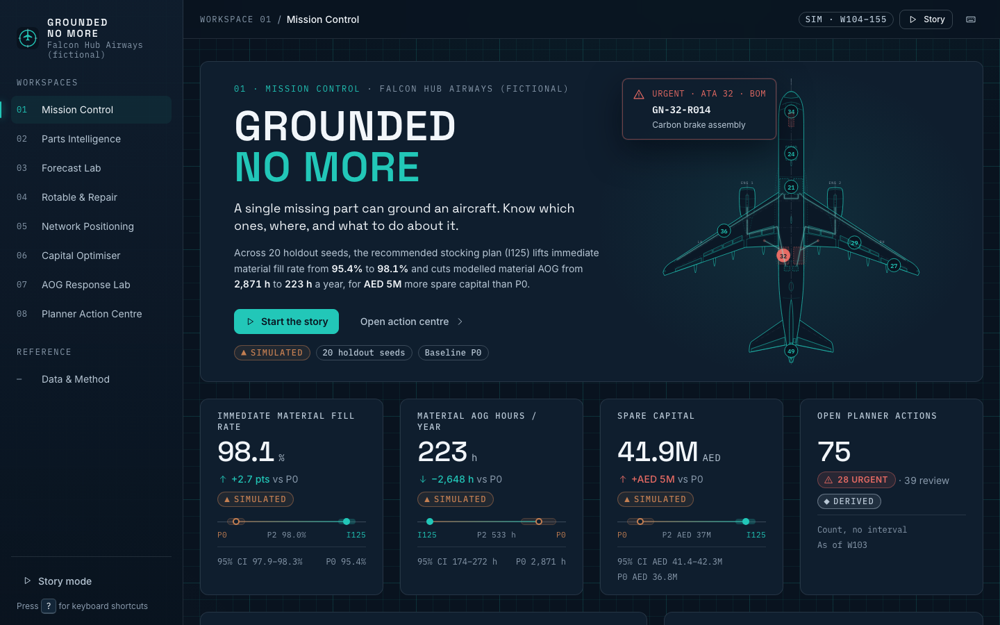

# GROUNDED NO MORE

**A single missing part can ground an aircraft. Know which ones, where, and what to do about it.**

[](https://github.com/akashgajjar07-hue/grounded-no-more/actions/workflows/ci.yml)

[](LICENSE)

**Live app:** <https://akashgajjar07-hue.github.io/grounded-no-more/>



An aviation spare-parts intelligence project for a fictional airline, **Falcon Hub Airways (fictional)**. It forecasts sparse, removal-driven demand, sizes rotable floats against repair turnaround, decides what to hold at the hub and what to push to outstations, and shows how much grounding risk each extra dirham of spares capital buys. Everything runs from one seeded pipeline and ends in a static web app a materials planner could use on a Monday morning.

> **All airline data in this project is simulated.** Station coordinates are real (OurAirports). Every parameter is in [`config/assumptions.yaml`](config/assumptions.yaml) with a provenance tag. Nothing here is measured aviation reliability or any operator's data.

---

## The story

It is 16:30 local (11:00 UTC) at Mumbai. A narrowbody (fictional tail A6-FHU) about to fly back to Abu Dhabi has a carbon brake assembly removed on the walk-round. The engineer raises a demand: one unit of **GN-32-R014**, needed before the next departure (deadline class D0).

BOM holds no serviceable spare. Under the legacy rule, the whole float for this part sits at AUH. The AOG desk books the next suitable flight out, and the aircraft waits for the AUH-to-BOM AOG transport time (9 hours, an ASSUMED planning value covering next flight out, handling and customs) before the unit lands and is fitted. In the simulated history this exact incident is AOG-0001: 9 h on the ground. Meanwhile the removed unit starts its own journey: back to AUH as an unserviceable core, on to the vendor shop in Europe, into a repair queue.

Nothing went "wrong" here. The removal rate, the repair turnaround and the positioning rule together made this grounding likely. That is the question this project answers at fleet scale: which parts, at which stations, carry the AOG risk, and what is the cheapest way to take that risk off the table.

The full worked example for GN-32-R014 at BOM is in the [study guide](STUDY_GUIDE.md#end-to-end-worked-example-gn-32-r014-at-bom).

---

## Six questions this answers

Headline numbers are from the **holdout**: 20 paired seeds (1000–1019), 52 weeks, run once after the freeze, central calibration variant. Selection-seed numbers appear only where labelled.

**1. Which parts drive AOG risk?**
Of 120 part numbers, 22 are flagged urgent (at least 25 risk-hours a year: legacy-history AOG hours plus modelled residual AOG under the recommended plan). Together they account for 95% of the legacy (P0) history's AOG hours. The riskiest part is GN-34-C023, Connector backshell kit – variant B, at 488 risk-hours a year, with most of its grounding hours at AUH (99% of its history AOG hours).

**2. Which forecasting method wins, by demand class? Does the reliability model beat the Croston family?**
Frozen champions by Syntetos–Boylan class (chosen on the selection window): smooth: SBA (consumables), SBA (expendables), SBA (rotables); erratic: TSB (consumables); intermittent: IMAPA (consumables), TSB (expendables), naive (rotables); lumpy: no part number falls in the lumpy class in this world. On the holdout, the frozen intermittent-rotable champion ranked 9 of 9, which is reported as-is; the policies size rotables on the reliability rate instead, so they do not depend on it.
For removal-driven parts (expendables and rotables, holdout) the exposure-based reliability model scores mean MASE 0.914 against 0.901 for the best Croston-family method (TSB), a paired difference of +0.013 (95% CI [−0.010 to 0.037]). Verdict: the reliability model does not beat the best Croston-family method on MASE; the difference is not significant, so it is a tie on point accuracy (75 parts, 95% bootstrap CI over parts). Where it does win is the upper quantile that stocking depends on: it has the lowest q90 pinball loss of all methods for both expendables and rotables on the holdout (expendables 0.272 vs next best 0.282; rotables 0.246 vs next best 0.260).

**3. What float and reorder points do we recommend, versus the baseline?**
The recommended plan (I125) holds 263 serviceable rotable units, against 189 under P2 and 134 under legacy rules (serviceable base stock; the 123 units seeded in the repair loop are common to all three). Consumable and expendable reorder points change on 377 of 560 PN-station lines versus P0.

**4. Hub or outstation?**
Mostly hub. P1 sizes every station's float on its own demand and puts 259 rotable units at outstations. P2 pools the float at AUH and positions only 42 units forward, where a D0 miss is expensive enough to pay for the unit (P0 has 5). P2 cuts AOG hours by 67% versus P1 (paired −1,093 h [−1,415 to −770]) while holding AED 27.6M less capital. At the six outstations alone, P1's 259 forward units do buy something: outstation AOG is 60 h a year under P1 against 162 h under P2 (P2 − P1 paired +102 h [45–158]) and 1,150 h under P0. But that is about 102 hours for AED 27.6M of extra capital, while starving the hub costs P1 1,195 h a year more than P2 at AUH.

**5. What does the Readiness Frontier recommend?**
The pre-stated rule picks I125 (P2 plus greedy rotable additions). At a spares capital of AED 41.9M, material AOG falls to 223 h a year (95% CI [174–272]), against 2,871 h for the legacy baseline at AED 36.8M. Against P2 it is −310 h [−408 to −212] for +AED 4.8M of capital, saving AED 5.4M [3.4–7.4] a year net of holding cost. Two honest caveats: on the selection seeds the same point scored 118 h (outside the holdout CI), and in the low-stress world I125 is not worth its extra capital over P2: on the selection seeds it saved 3.5 AOG h/yr [−3.9 to 10.8] versus P2 at a net annual cost of AED 0.95M [0.73–1.17], and the rule picks P2 there (the frontier holdout ran the central variant only).

**6. What should the planner do this week?**
At week 103 the Planner Action Centre raises 75 actions, 28 urgent. The first three in the inbox: GN-30-E025 recent PO lead time 134 d vs quoted 65 d (2.0x) (urgent: update planning lead time to ~134 d and recompute the reorder point; ask the supplier for a recovery date); GN-28-R031 at FRA: 0 serviceable (+0 inbound) vs target 1 (demand-implied protection level); 2 D0 requests and 63 AOG h in 52 weeks (urgent: position 1 unit(s) at FRA (raise the station target from 0 to 1); send from AUH stock); GN-32-R014 at BOM: 0 serviceable (+0 inbound) vs target 2 (demand-implied protection level); 7 D0 requests and 63 AOG h in 52 weeks (urgent: position 2 unit(s) at BOM (raise the station target from 0 to 2); send from AUH stock).

---

## Signature features

| Feature | What it does |
|---|---|
| **Readiness Frontier** | Capital vs expected AOG hours for every budget. Each point is an allocation you can open line by line, with paired-seed confidence intervals. |
| **AOG Response Lab** | Replays the simulated history's groundings. For each one, compares local stock, emergency transfer, lateral, accelerated repair, expedite purchase and (indicative only) pool exchange on wait time, cost and whether the deadline holds. |
| **Planner Action Centre** | A weekly inbox of exceptions (shortfall at an outstation, overdue repair order, excess stock, lead-time jump) with evidence and a recommended action. |
| **Forecast Lab** | Demand classification (ADI, CV²), method leaderboard by class, and a check of how well each method recovers the hidden true rates. |
| **Rotable & Repair** | Serial lifecycle flows, the live repair queue, TAT and float sizing from Palm's theorem. |
| **Network Positioning** | Hub and six outstations, stock and risk by station, transfer replay and policy comparison. |

---

## How it works


1. **Simulate a world.** A seeded generator builds a fictional 40-aircraft fleet, its flights, and the removals, kit demands and line usage those flights cause. True failure rates stay hidden in `data/ground_truth/`.
2. **Record a history.** One event engine runs the airline for 104 weeks under legacy rules (P0). Its output looks like what a materials planner would pull from an MRO system: requests, repair orders, POs, transfers and AOG events.
3. **Plan from the history only.** Forecasting, float sizing, positioning and the frontier optimiser see only the history and the part master, never the truth. A static scan of the source and a runtime audit test check this.
4. **Evaluate fairly.** Every policy runs through the same engine on the same paired seeds. Parameters are frozen and hashed before the 52-week holdout runs once.
5. **Ship.** Results export to JSON and a static app on GitHub Pages. Every number on screen is read from the exported JSON, and `tests/test_reconciliation.py` recomputes the headline KPIs, policy tables, frontier flags and station means from `outputs/`.

Method details: [METHODOLOGY.md](METHODOLOGY.md). Model scope: [MODEL_CARD.md](MODEL_CARD.md). Validation: [reports/VALIDATION_REPORT.md](reports/VALIDATION_REPORT.md).

**Checked against real data too.** The forecasting code was also run on a REAL public benchmark. Dataset: Monash Car Parts (without missing values), 2,674 monthly series, licence CC BY 4.0, data provenance REAL (metrics DERIVED). Best eligible method IMAPA with mean MASE 1.056 [1.011–1.109]; the all-zero forecast scores 0.777, which is why zero is never allowed to be a champion; the bootstrap's q90 coverage is 0.909. Attribution: Car Parts dataset, Monash Time Series Forecasting Archive (Godahewa, Bergmeir, Webb, Hyndman & Montero-Manso, 2021), Zenodo record 4656021, licensed CC BY 4.0; original data from Hyndman (2015), R package expsmooth.

**Tests:** 345/345 passing (fast, slow and browser suites; `reports/test_results.txt`, commit 957dfd3).

---

## Data provenance

| Tag | Meaning | Examples here |
|---|---|---|
| **REAL** | From a public, cited dataset | Station names and coordinates (OurAirports) |
| **DERIVED** | Computed in this repo from other data | Demand classes, forecasts, float levels, planner exceptions |
| **ASSUMED** | A planning assumption chosen by the author, with rationale | Utilisation, MTBUR ranges, repair TAT ranges, AOG penalty per hour, carrying cost 20%/yr |
| **SIMULATED** | Produced by the synthetic generator | Fleet, flights, removals, requests, repair orders, AOG events |

Every table and every exported JSON object carries its tag. The full list of parameters is in the [assumption register](docs/assumption_register.md); every column is in the [data dictionary](data/data_dictionary.md).

---

## Results

Holdout: 52 weeks (weeks 104–155), 20 paired seeds (1000–1019), central variant, run once after the freeze. Means with 95% confidence intervals (t-interval over seeds). Capital is shown separately and is never added to annual cost. I125 is the recommended frontier point.

| KPI | P0 Legacy rules | P1 Local optimised | P2 Network | I125 Recommended (P2 + greedy additions) |
|---|---|---|---|---|
| Immediate fill rate | 95.4% [95.2–95.6] | 98.2% [98.0–98.4] | 98.0% [97.7–98.2] | 98.1% [97.9–98.3] |
| Material AOG hours / yr | 2,871 h [2,459–3,282] | 1,626 h [1,243–2,008] | 533 h [419–646] | 223 h [174–272] |
| AOG events / yr | 86.2 [79.5–93.0] | 26.8 [21.5–32.1] | 20.4 [15.5–25.4] | 8.8 [6.5–11.1] |
| Spares capital | AED 36.8M [36.2–37.4] | AED 64.6M [64.1–65.1] | AED 37.0M [36.5–37.6] | AED 41.9M [41.4–42.3] |
| Annual operating cost excl. AOG penalty | AED 25.9M | AED 30.8M | AED 26.0M | AED 26.8M |
| Annual AOG penalty, scenario | AED 60.1M | AED 32.3M | AED 10.8M | AED 4.6M |
| Total annual cost (opex + penalty) | AED 86.0M [77.5–94.5] | AED 63.1M [55.8–70.4] | AED 36.8M [34.4–39.3] | AED 31.4M [30.4–32.5] |
| Paired difference in AOG hours vs P0 | — | −1,245 h [−1,608 to −883] | −2,338 h [−2,709 to −1,967] | n/a ¹ |
| Paired difference in AOG hours vs P2 | +2,338 h [1,967–2,709] | +1,093 h [770–1,415] | — | −310 h [−408 to −212] |

¹ The frontier holdout run recorded paired differences against the base policy P2 only, so no paired I125 − P0 interval exists. Money is AED; CIs on money are in AED millions.

**Selection versus holdout.** The recommended point was chosen on selection seeds 100–119, where it scored 118 h of material AOG a year [92–144]. On the holdout it scored 223 h (+89%), and the selection value lies outside the holdout CI. P2 moved the same way but less (428 h on selection, 533 h on holdout, +24%): the plan picked on selection seeds lost the most, a winner's-curse effect. The paired gap to P2 held (−310 h [−383 to −238] on selection, −310 h [−408 to −212] on holdout), and the ranking P0 > P1 > P2 > I125 on AOG hours held.

**Where the methods do not win.** The reliability model never beats the best Croston-family method on mean MASE (holdout difference +0.013 [−0.010 to 0.037]), though it has the best q90 pinball loss for expendables and rotables. The frozen naive champion for intermittent rotables ranked 9 of 9 on the holdout. P2 spends more on expediting than P0 (paired +AED 0.25M [0.13–0.37] a year) and fills slightly fewer requests immediately than P1 (−0.21 pp [−0.34 to −0.08]). In the low-stress world I125 is not worth its extra capital over P2: on the selection seeds it saved 3.5 AOG h/yr [−3.9 to 10.8] versus P2 at a net annual cost of AED 0.95M [0.73–1.17], and the rule picks P2 there (the frontier holdout ran the central variant only). Every policy leans on the 5-day AOG-desk emergency buy: with it switched off (selection seeds) material AOG rises from 428 h to 14,400 h a year under P2, from 118 h to 11,230 h under I125, and from 2,938 h to 268,500 h under P0.

These are results on simulated data from assumed parameters. They show that the method works and how large the effects can be under those assumptions. They are not a forecast of any real airline's performance.

---

## Limitations

The short version: the data is synthetic, the deadline classes are hypothetical (not MEL), grounded aircraft keep accruing flying exposure, the repair shop model is simple, the network is close to single-echelon, the AOG penalty is a scenario value, the optimiser is a greedy heuristic, and every policy (legacy included) leans on an AOG-desk emergency buy that delivers a rotable within 5 days: with it switched off (selection seeds) material AOG rises from 428 h to 14,400 h a year under P2, from 118 h to 11,230 h under I125, and from 2,938 h to 268,500 h under P0. The full, specific list is in [LIMITATIONS.md](LIMITATIONS.md).

---

## Reproduce

Requires Python 3.11 or later.

```bash
git clone https://github.com/akashgajjar07-hue/grounded-no-more.git
cd grounded-no-more
python -m venv .venv
source .venv/bin/activate          # Windows: .venv\Scripts\activate
pip install -r requirements.txt
pip install -e .
python scripts/run_all.py          # history -> forecasting -> policies -> frontier -> AOG lab -> export -> docs
python scripts/run_all.py --check  # same, then verify every frozen artefact re-derives byte-identically
pytest -m "not slow and not browser"
```

`run_all.py` reproduces the selection stage and re-exports from the committed holdout outputs. The holdout itself ran once, after `python scripts/freeze_all.py` hashed every frozen artefact into `outputs/freeze/manifest.json`; `python scripts/run_holdout.py` refuses to run if a hash differs and logs every run. `python scripts/render_docs.py` fills the numbers in these docs from `outputs/`. Seeds are fixed in `config/assumptions.yaml`, so a clean run reproduces every number.

---

## Project structure

```
config/assumptions.yaml     every parameter, with provenance and rationale
src/gnm/
  schemas.py, contracts.py  data contract (tables, enums, in-memory objects)
  sim/                      generator (owns hidden truth) + policy-agnostic event engine
  forecasting/              demand classification, Croston family, bootstrap, reliability model
  policy/                   P1/P2 parameter tables (float, ROP, positioning), Palm/EBO maths, paired evaluation
  optim/                    greedy marginal allocation and the Readiness Frontier
  aog/                      AOG Response Lab option evaluation
  eval/                     truth recovery (the only reader of ground truth)
  export/                   JSON exports for the web app
scripts/                    build_history, run_forecasting, evaluate_policies, run_frontier, run_aog_lab,
                            freeze_all, run_holdout, export_site, render_docs, ...
data/                       processed/ (Parquet + DuckDB), ground_truth/ (hidden), holdout/
outputs/                    pipeline outputs, freeze manifest
docs/                       static web app (GitHub Pages), method docs, templates/ for these docs
tests/                      contracts, leakage, conservation, freeze, reconciliation, site, rendered docs
reports/                    test results, VALIDATION_REPORT.md
```

---

## Why this matters

Spares are one of the largest capital lines in an airline's engineering budget, and most of the money sits in a small number of expensive rotables with sparse, lumpy demand. Too little stock in the wrong place grounds aircraft; too much ties up capital for years. Getting the trade-off right is a planning problem, not a purchasing one.

Relevant to Abu Dhabi hub carriers and MRO organisations; independent project, not affiliated with any airline.

---

## Author

**Akash Gajjar**
MSc Supply Chain Management, University of Liverpool (2025). Retail operations and inventory experience at Primark and Uniqlo. Interested in materials planning, inventory analysis and supply chain planning in aviation and MRO.

- GitHub: [akashgajjar07-hue](https://github.com/akashgajjar07-hue)
- LinkedIn: *add link*

---

## Licence

Code is released under the [MIT licence](LICENSE). Third-party components and their licences are listed in [THIRD_PARTY_LICENSES.md](THIRD_PARTY_LICENSES.md).

This is an independent educational project. It is not an approved maintenance, airworthiness or dispatch tool.
